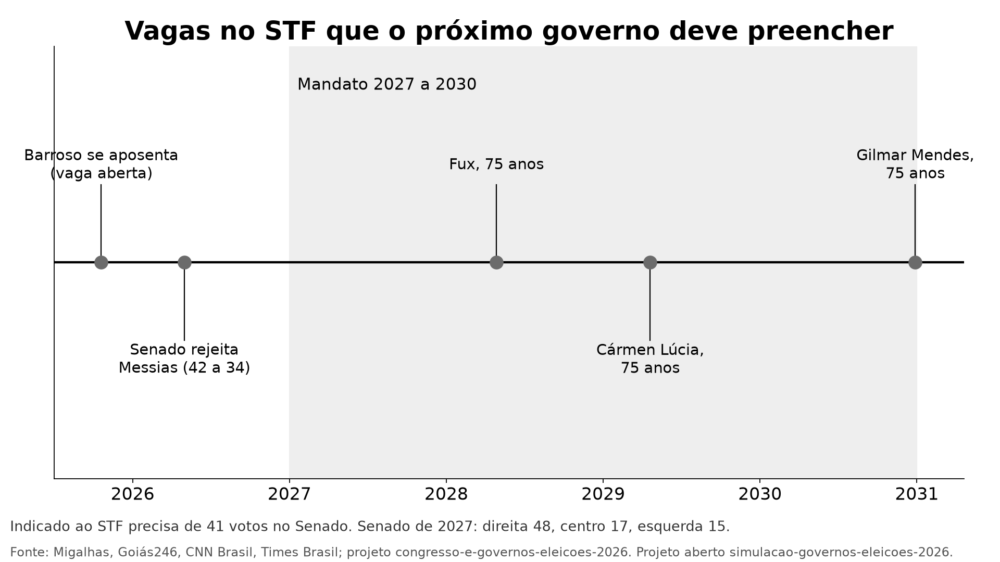

# Simulação: como tendem a andar seis temas no Brasil de 2027 a 2030, com Lula ou com Flávio Bolsonaro

**Gerado em 2026-10-20 a partir de `resultados/RESUMO.json` e `resultados/SIMULACAO_DIVIDA.json`.** Análise feita pelo **Claude**, modelo de IA da Anthropic, posto pelo autor para analisar com regras escritas antes ([`docs/PRE_REGISTRO.md`](docs/PRE_REGISTRO.md), commit `1e73d27`, público antes de qualquer nota). Leitura em uma página: [`RESUMO_SIMPLES.md`](RESUMO_SIMPLES.md). A opinião da IA, tema por tema: [`docs/LEITURA_DA_IA.md`](docs/LEITURA_DA_IA.md).

## O que este projeto não consegue dizer

- **Quem vai ganhar o 2º turno de 25/10/2026, nem quem deveria ganhar.** A IA não soma os temas num placar e não diz quem é melhor para o país ([`docs/LIMITE_ELEITORAL.md`](docs/LIMITE_ELEITORAL.md), Resolução TSE nº 23.755/2026, art. 28, §1º-C). Cada tema fecha com o seu veredito.
- **Se um governo causou a variação de um indicador.** O histórico é o que aconteceu durante o mandato, descontado o que aconteceu no resto do mundo quando há série comparável. Pandemia, guerra e preço de commodities interferem.
- **Flávio Bolsonaro nunca governou.** O histórico usado para ele é o do governo Jair Bolsonaro (2019 a 2022), que o plano dele apresenta como referência ("Nós já mostramos que o caminho é outro", p. 29). Ele pode governar diferente.
- **O valor de uma proposta.** O critério de caminho mede o que ela precisa para sair do papel; o de maturidade, o quanto se sabe do efeito. Uma proposta nova pode ser melhor que uma antiga, e uma emenda à Constituição pode ser melhor que um decreto.
- **Temas fora dos seis** (meio ambiente, política externa, cultura e outros), escolhidos pela regra das pesquisas da §1 do pré-registro.

## 1. A pergunta e o método, em uma tela

- **Seis temas**, pela regra escrita antes: o que pelo menos 5% dos brasileiros citam como principal problema em 3 dos 5 levantamentos de 2026 (Datafolha, Quaest/Globo, Quaest/Pax, BTG/Nexus, Paraná Pesquisas). Entraram segurança, saúde, economia, corrupção, educação e pobreza, fome e desigualdade.
- **Quatro subtemas fixos por tema**, iguais para os dois lados, e em cada um a primeira ação concreta do plano registrado no TSE (46 propostas, 2 subtemas sem proposta, trecho literal conferido no PDF).
- **Seis critérios**: C1 histórico, C2 promessa e entrega (g1, mesma metodologia para os dois), C3 caminho de execução (o instrumento que a proposta exige e o Congresso de 2027), C4 maturidade e evidência, C5 dinheiro e, só na economia, C6 mercado.
- **Pesos**: C3 30, C1 25, C4 20, C2 15, C5 10 (na economia, C3 25, C1 20, C4 20, C6 15, C2 10, C5 10). Veredito do tema com diferença de 5 pontos ou mais; abaixo disso, empate. Refeito com 3 pesos alternativos.
- **Fontes**: toda evidência tem o trecho conferido letra por letra na página capturada (181 trechos em `resultados/TRECHOS_CONFERIDOS.csv`); séries oficiais com hash em `dados/MANIFESTO.csv`.

## 2. Resultado por tema

| Tema | Nota de Lula | Nota de Flávio | Diferença | Veredito do tema | Robustez (4 pesos escritos antes) | O que mais pesou |
|---|---:|---:|---:|---|---|---|
| Segurança | 61,2 | 42,7 | +18,5 | **Lula** | firme | histórico (a favor de Lula, 8,4 pontos na nota); promessa e entrega (a favor de Lula, 5,5 pontos na nota); caminho de execução (a favor de Lula, 4,5 pontos na nota) |
| Saúde | 76,1 | 55,0 | +21,0 | **Lula** | firme | histórico (a favor de Lula, 8,4 pontos na nota); promessa e entrega (a favor de Lula, 5,5 pontos na nota); caminho de execução (a favor de Lula, 4,5 pontos na nota) |
| Economia | 58,5 | 51,6 | +6,9 | **Lula** | firme | mercado (a favor de Flávio, 15,0 pontos na nota); caminho de execução (a favor de Lula, 8,8 pontos na nota); histórico (a favor de Lula, 4,0 pontos na nota) |
| Corrupção | 51,8 | 54,5 | -2,7 | **empate** | depende do peso | histórico (a favor de Flávio, 12,5 pontos na nota); promessa e entrega (a favor de Lula, 5,5 pontos na nota); caminho de execução (a favor de Lula, 4,0 pontos na nota) |
| Educação | 74,7 | 47,5 | +27,2 | **Lula** | firme | histórico (a favor de Lula, 12,5 pontos na nota); caminho de execução (a favor de Lula, 6,0 pontos na nota); promessa e entrega (a favor de Lula, 5,5 pontos na nota) |
| Pobreza, fome e desigualdade | 74,8 | 50,3 | +24,5 | **Lula** | firme | histórico (a favor de Lula, 8,4 pontos na nota); maturidade e evidência (a favor de Lula, 6,3 pontos na nota); promessa e entrega (a favor de Lula, 5,5 pontos na nota) |

**Quem fica na frente em cada critério, tema a tema** (nota de Lula × nota de Flávio):

| Tema | Histórico | Promessa e entrega | Caminho de execução | Maturidade e evidência | Dinheiro | Mercado |
|---|---|---|---|---|---|---|
| Segurança | Lula (67 × 33) | Lula (78 × 41) | Lula (76 × 61) | Lula (50 × 42) | Flávio (0 × 12) | não se aplica |
| Saúde | Lula (67 × 33) | Lula (78 × 41) | Lula (100 × 85) | Lula (82 × 75) | Lula (12 × 0) | não se aplica |
| Economia | Lula (60 × 40) | Lula (78 × 41) | Lula (95 × 60) | Lula (50 × 35) | Lula (50 × 25) | Flávio (0 × 100) |
| Corrupção | Flávio (25 × 75) | Lula (78 × 41) | Lula (72 × 58) | Lula (45 × 35) | Flávio (33 × 50) | não se aplica |
| Educação | Lula (75 × 25) | Lula (78 × 41) | Lula (100 × 80) | Lula (65 × 42) | Flávio (12 × 25) | não se aplica |
| Pobreza, fome e desigualdade | Lula (67 × 33) | Lula (78 × 41) | Lula (100 × 85) | Lula (82 × 51) | empate (0 × 0) | não se aplica |

## 3. Tema a tema

### Segurança

**Veredito do tema, pelos critérios escritos antes: Lula** (Lula 61,2, Flávio 42,7; firme). O que mais pesou: histórico (a favor de Lula, 8,4 pontos na nota); promessa e entrega (a favor de Lula, 5,5 pontos na nota); caminho de execução (a favor de Lula, 4,5 pontos na nota). Com outros pesos: pesos iguais: Lula (54,1 × 38,2); histórico pesa mais: Lula (62,5 × 39,4); execução pesa mais: Lula (62,1 × 46,5).

**Histórico (C1).**

| Indicador | Bolsonaro (2019 a 2022) | Lula (2023 até o dado mais recente) | Quem fica na frente | Fonte |
|---|---:|---:|---|---|
| Mortes violentas intencionais por 100 mil, variação ao ano | -1,30 | -1,20 | empate (diferença menor que a mínima) | Anuário FBSP 2026 |
| Roubo de veículo por 100 mil veículos, variação ao ano (%) | -14,91 | -14,32 | empate (diferença menor que a mínima) | Anuários FBSP 2019, 2023 e 2026 |
| Estelionato registrado, variação ao ano (%) | 43,69 | 7,51 | Lula | Anuários FBSP 2023 e 2026 |

**Propostas de 2026 (C3, C4 e C5).** Promessa e entrega (C2) é a mesma em todos os temas: Lula 77,8, Flávio 41,4 (governo Jair Bolsonaro).

| Lado | Subtema | Proposta (página do plano) | Caminho (C3) | Maturidade (C4) | Dinheiro (C5) |
|---|---|---|---:|---:|---:|
| Lula | a | Manter a asfixia financeira do crime organizado, com a Lei Antifacção sancionada em 2026 (p. 27) | 100 | 65 | 0 |
| Lula | b | Cumprir as metas do Plano Pena Justa e criar o Pacto Nacional de Execução Penal (p. 28) | 80 | 35 | 0 |
| Lula | c | Manter a política de controle de armas e munições (revogação dos decretos de acesso a armas) (p. 28) | 100 | 65 | 0 |
| Lula | d | Criar o Ministério da Segurança Pública depois de aprovada a PEC da Segurança (repetida no debate) (p. 30) | 25 | 35 | 0 |
| Flávio | a | Declarar PCC, CV e milícias organizações narcoterroristas (repetida no debate) (p. 13) | 60 | 35 | 50 |
| Flávio | b | Reduzir a maioridade penal de 18 para 16 anos, e punir maiores de 14 por crimes graves (repetida no debate) (p. 13) | 25 | 35 | 0 |
| Flávio | c | Criar o Sistema Nacional de Fronteira com Exército, Marinha e Aeronáutica (repetida no debate) (p. 13) | 80 | 35 | 0 |
| Flávio | d | Consórcios e convênios com estados e municípios para investir em inteligência, territórios e polícia (p. 13) | 80 | 65 | 0 |

**Cenário 2027 a 2030.**

**Caminho de Lula.** Com caminho provável e faixa estreita (já funciona ou tem evidência de efeito): manter a asfixia financeira do crime organizado, com a Lei Antifacção sancionada em 2026; manter a política de controle de armas e munições (revogação dos decretos de acesso a armas). Com caminho provável e faixa larga (efeito pouco conhecido, pode dar muito certo ou muito errado): cumprir as metas do Plano Pena Justa e criar o Pacto Nacional de Execução Penal. Dependem do Congresso, com caminho mais difícil: criar o Ministério da Segurança Pública depois de aprovada a PEC da Segurança (repetida no debate).

**Caminho de Flávio.** Com caminho provável e faixa estreita (já funciona ou tem evidência de efeito): consórcios e convênios com estados e municípios para investir em inteligência, territórios e polícia. Com caminho provável e faixa larga (efeito pouco conhecido, pode dar muito certo ou muito errado): declarar PCC, CV e milícias organizações narcoterroristas (repetida no debate); criar o Sistema Nacional de Fronteira com Exército, Marinha e Aeronáutica (repetida no debate). Dependem do Congresso, com caminho mais difícil: reduzir a maioridade penal de 18 para 16 anos, e punir maiores de 14 por crimes graves (repetida no debate).

### Saúde

**Veredito do tema, pelos critérios escritos antes: Lula** (Lula 76,1, Flávio 55,0; firme). O que mais pesou: histórico (a favor de Lula, 8,4 pontos na nota); promessa e entrega (a favor de Lula, 5,5 pontos na nota); caminho de execução (a favor de Lula, 4,5 pontos na nota). Com outros pesos: pesos iguais: Lula (67,9 × 46,9); histórico pesa mais: Lula (71,7 × 46,1); execução pesa mais: Lula (80,5 × 62,4).

**Histórico (C1).**

| Indicador | Bolsonaro (2019 a 2022) | Lula (2023 até o dado mais recente) | Quem fica na frente | Fonte |
|---|---:|---:|---|---|
| Esperança de vida, Brasil menos América Latina, variação ao ano (anos) | -0,09 | -0,01 | empate (diferença menor que a mínima) | Banco Mundial (OMS/ONU) |
| Mortalidade infantil, Brasil menos América Latina, variação ao ano (por mil) | 0,12 | 0,15 | empate (diferença menor que a mínima) | Banco Mundial (OMS/ONU) |
| Vacina de sarampo, Brasil menos América Latina, variação ao ano (p.p.) | -0,17 | 3,42 | Lula | Banco Mundial (OMS/ONU) |

**Propostas de 2026 (C3, C4 e C5).** Promessa e entrega (C2) é a mesma em todos os temas: Lula 77,8, Flávio 41,4 (governo Jair Bolsonaro).

| Lado | Subtema | Proposta (página do plano) | Caminho (C3) | Maturidade (C4) | Dinheiro (C5) |
|---|---|---|---:|---:|---:|
| Lula | a | Manter o apoio à expansão e qualificação das equipes de Saúde da Família (p. 34) | 100 | 100 | 0 |
| Lula | b | Impulsionar o Agora Tem Especialistas (filas de consultas, exames e cirurgias; repetida no debate) (p. 37) | 100 | 65 | 50 |
| Lula | c | Consolidar o prontuário único do cidadão pela Rede Nacional de Dados em Saúde (p. 35) | 100 | 65 | 0 |
| Lula | d | Manter o Farmácia Popular 100% gratuito e incluir exames (p. 36) | 100 | 100 | 0 |
| Flávio | a | Ampliar a Estratégia Saúde da Família (p. 37) | 80 | 100 | 0 |
| Flávio | b | Corrigir a tabela SUS para hospitais, santas casas e clínicas (p. 37) | 80 | 35 | 0 |
| Flávio | c | Implantar o prontuário eletrônico único ligado ao CPF (repetida no debate) (p. 26) | 80 | 65 | 0 |
| Flávio | d | Manter a imunização e incentivar a produção nacional de vacinas (p. 37) | 100 | 100 | 0 |

**Cenário 2027 a 2030.**

**Caminho de Lula.** Com caminho provável e faixa estreita (já funciona ou tem evidência de efeito): manter o apoio à expansão e qualificação das equipes de Saúde da Família; impulsionar o Agora Tem Especialistas (filas de consultas, exames e cirurgias; repetida no debate); consolidar o prontuário único do cidadão pela Rede Nacional de Dados em Saúde; manter o Farmácia Popular 100% gratuito e incluir exames.

**Caminho de Flávio.** Com caminho provável e faixa estreita (já funciona ou tem evidência de efeito): ampliar a Estratégia Saúde da Família; implantar o prontuário eletrônico único ligado ao CPF (repetida no debate); manter a imunização e incentivar a produção nacional de vacinas. Com caminho provável e faixa larga (efeito pouco conhecido, pode dar muito certo ou muito errado): corrigir a tabela SUS para hospitais, santas casas e clínicas.

### Economia

**Veredito do tema, pelos critérios escritos antes: Lula** (Lula 58,5, Flávio 51,6; firme). O que mais pesou: mercado (a favor de Flávio, 15,0 pontos na nota); caminho de execução (a favor de Lula, 8,8 pontos na nota); histórico (a favor de Lula, 4,0 pontos na nota). Com outros pesos: pesos iguais: Lula (55,5 × 50,2); histórico pesa mais: Lula (59,1 × 46,3); execução pesa mais: Lula (65,0 × 50,6).

**Histórico (C1).**

| Indicador | Bolsonaro (2019 a 2022) | Lula (2023 até o dado mais recente) | Quem fica na frente | Fonte |
|---|---:|---:|---|---|
| PIB real, Brasil menos emergentes (p.p. ao ano, média) | -1,90 | -1,53 | Lula | FMI WEO |
| Inflação, Brasil menos emergentes (p.p. ao ano, média) | -0,38 | -2,47 | Lula | FMI WEO |
| Desemprego, variação ao ano (p.p.; até 08/2026) | -0,95 | -0,71 | Bolsonaro | IBGE, PNAD Contínua (SIDRA 6381) |
| Dívida bruta do governo geral, variação ao ano (p.p. do PIB; até 08/2026) | -0,90 | 3,05 | Bolsonaro | Banco Central (SGS 13762) |
| Rendimento médio real do trabalho, variação ao ano (%; até 08/2026) | -0,25 | 3,61 | Lula | IBGE, PNAD Contínua (SIDRA 6390) |

**Propostas de 2026 (C3, C4 e C5).** Promessa e entrega (C2) é a mesma em todos os temas: Lula 77,8, Flávio 41,4 (governo Jair Bolsonaro).

| Lado | Subtema | Proposta (página do plano) | Caminho (C3) | Maturidade (C4) | Dinheiro (C5) |
|---|---|---|---:|---:|---:|
| Lula | a | Manter o novo arcabouço fiscal (p. 49) | 100 | 35 | 100 |
| Lula | b | Consolidar a reforma tributária do consumo em implementação (p. 48) | 100 | 65 | 50 |
| Lula | c | Manter os fundos garantidores, o controle de gastos com apostas e aprimorar regras de crédito (p. 49) | 80 | 35 | 50 |
| Lula | d | Fortalecer o Sistema Público de Emprego, Trabalho e Renda e a qualificação profissional (p. 74) | 100 | 65 | 0 |
| Flávio | a | Reformular as regras fiscais com foco na dívida, superávits e controle de gastos dos três Poderes (p. 71) | 60 | 35 | 100 |
| Flávio | b | Rever e redimensionar a reforma tributária para reduzir o IVA (p. 30) | 60 | 35 | 0 |
| Flávio | c | Simplificar a conta de luz e reduzir CDE, encargos e impostos sobre energia e combustíveis (p. 31) | 60 | 35 | 0 |
| Flávio | d | Reduzir gradualmente o custo do trabalho e criar contrato de primeiro emprego de 18 a 24 anos (p. 43) | 60 | 35 | 0 |

**Cenário 2027 a 2030.**

**Caminho de Lula.** Com caminho provável e faixa estreita (já funciona ou tem evidência de efeito): consolidar a reforma tributária do consumo em implementação; fortalecer o Sistema Público de Emprego, Trabalho e Renda e a qualificação profissional. Com caminho provável e faixa larga (efeito pouco conhecido, pode dar muito certo ou muito errado): manter o novo arcabouço fiscal; manter os fundos garantidores, o controle de gastos com apostas e aprimorar regras de crédito.

**Caminho de Flávio.** Com caminho provável e faixa larga (efeito pouco conhecido, pode dar muito certo ou muito errado): reformular as regras fiscais com foco na dívida, superávits e controle de gastos dos três Poderes; rever e redimensionar a reforma tributária para reduzir o IVA; simplificar a conta de luz e reduzir CDE, encargos e impostos sobre energia e combustíveis; reduzir gradualmente o custo do trabalho e criar contrato de primeiro emprego de 18 a 24 anos.

### Corrupção

**Veredito do tema, pelos critérios escritos antes: empate** (Lula 51,8, Flávio 54,5; depende do peso). O que mais pesou: histórico (a favor de Flávio, 12,5 pontos na nota); promessa e entrega (a favor de Lula, 5,5 pontos na nota); caminho de execução (a favor de Lula, 4,0 pontos na nota). Com outros pesos: pesos iguais: empate (50,6 × 51,9); histórico pesa mais: Flávio (47,7 × 58,4); execução pesa mais: empate (56,1 × 53,6).

**Histórico (C1).**

| Indicador | Bolsonaro (2019 a 2022) | Lula (2023 até o dado mais recente) | Quem fica na frente | Fonte |
|---|---:|---:|---|---|
| Índice de Percepção da Corrupção, Brasil menos média mundial, variação ao ano (pontos) | 0,75 | -0,67 | Bolsonaro | Transparência Internacional |
| Controle da Corrupção (Banco Mundial, nota 0 a 100), variação ao ano | -0,13 | 0,51 | empate (diferença menor que a mínima) | Banco Mundial (WGI) |

**Propostas de 2026 (C3, C4 e C5).** Promessa e entrega (C2) é a mesma em todos os temas: Lula 77,8, Flávio 41,4 (governo Jair Bolsonaro).

| Lado | Subtema | Proposta (página do plano) | Caminho (C3) | Maturidade (C4) | Dinheiro (C5) |
|---|---|---|---:|---:|---:|
| Lula | a | Aprofundar o Plano de Integridade e Combate à Corrupção 2025-2027 (p. 18) | 100 | 65 | 50 |
| Lula | b | Portal da Transparência com dados abertos e inteligência artificial (p. 18) | 80 | 35 | 0 |
| Lula | c | Medidas rígidas para barrar candidaturas de pessoas ligadas ao crime organizado (p. 27) | 35 | 35 | 50 |
| Lula | d | *sem proposta no plano*: O plano não traz ação sobre governança de estatais ou fraude em benefícios; a defesa de estatais fortes (debate) é posição de política econômica, não medida de integridade. | fora da média | fora da média | fora da média |
| Flávio | b | Mais transparência, controle e rastreabilidade das emendas parlamentares (p. 69) | 60 | 35 | 50 |
| Flávio | c | Reforma do STF: fim do foro criminal originário, limite a decisões individuais, quarentena (p. 65) | 35 | 35 | 50 |
| Flávio | d | Estatais com comando técnico: fortalecer a Lei das Estatais e recrutar com regras de mercado (p. 70) | 80 | 35 | 50 |
| Flávio | a | *sem proposta no plano*: O plano não traz ação sobre órgãos de controle, investigação ou integridade; a adesão à OCDE aparece no capítulo de política externa. | fora da média | fora da média | fora da média |

**Cenário 2027 a 2030.**

**Caminho de Lula.** Com caminho provável e faixa estreita (já funciona ou tem evidência de efeito): aprofundar o Plano de Integridade e Combate à Corrupção 2025-2027. Com caminho provável e faixa larga (efeito pouco conhecido, pode dar muito certo ou muito errado): portal da Transparência com dados abertos e inteligência artificial. Dependem do Congresso, com caminho mais difícil: medidas rígidas para barrar candidaturas de pessoas ligadas ao crime organizado.

**Caminho de Flávio.** Com caminho provável e faixa larga (efeito pouco conhecido, pode dar muito certo ou muito errado): mais transparência, controle e rastreabilidade das emendas parlamentares; estatais com comando técnico: fortalecer a Lei das Estatais e recrutar com regras de mercado. Dependem do Congresso, com caminho mais difícil: reforma do STF: fim do foro criminal originário, limite a decisões individuais, quarentena.

### Educação

**Veredito do tema, pelos critérios escritos antes: Lula** (Lula 74,7, Flávio 47,5; firme). O que mais pesou: histórico (a favor de Lula, 12,5 pontos na nota); caminho de execução (a favor de Lula, 6,0 pontos na nota); promessa e entrega (a favor de Lula, 5,5 pontos na nota). Com outros pesos: pesos iguais: Lula (66,1 × 42,8); histórico pesa mais: Lula (73,3 × 41,0); execução pesa mais: Lula (78,3 × 54,9).

**Histórico (C1).**

| Indicador | Bolsonaro (2019 a 2022) | Lula (2023 até o dado mais recente) | Quem fica na frente | Fonte |
|---|---:|---:|---|---|
| Ideb do ensino médio, variação por edição | 0,20 | 0,15 | empate (diferença menor que a mínima) | Inep (via Agência Brasil, Folha de Pernambuco e Inep) |
| Ideb dos anos iniciais, variação por edição | 0,00 | 0,25 | Lula | Inep (via Agência Brasil, Folha de Pernambuco e Inep) |

**Propostas de 2026 (C3, C4 e C5).** Promessa e entrega (C2) é a mesma em todos os temas: Lula 77,8, Flávio 41,4 (governo Jair Bolsonaro).

| Lado | Subtema | Proposta (página do plano) | Caminho (C3) | Maturidade (C4) | Dinheiro (C5) |
|---|---|---|---:|---:|---:|
| Lula | a | Seguir o Compromisso Nacional Criança Alfabetizada até 80% alfabetizados na idade certa (p. 31) | 100 | 65 | 0 |
| Lula | b | Continuar e fortalecer o Pé-de-Meia (p. 32) | 100 | 65 | 0 |
| Lula | c | Ampliar o apoio a creches e pré-escolas pelo Novo PAC (p. 31) | 100 | 65 | 50 |
| Lula | d | Pé-de-Meia Licenciatura e Bolsa Mais Professores (repetida no debate) (p. 33) | 100 | 65 | 0 |
| Flávio | a | Priorizar o método fônico na alfabetização (p. 35) | 80 | 65 | 50 |
| Flávio | b | Ampliar a educação técnica no ensino médio, com o setor produtivo (p. 36) | 80 | 35 | 50 |
| Flávio | c | Ampliar creches em período integral e dar voucher-creche onde faltar vaga (p. 21) | 80 | 35 | 0 |
| Flávio | d | Qualificação contínua de professores baseada em evidências (p. 35) | 80 | 35 | 0 |

**Cenário 2027 a 2030.**

**Caminho de Lula.** Com caminho provável e faixa estreita (já funciona ou tem evidência de efeito): seguir o Compromisso Nacional Criança Alfabetizada até 80% alfabetizados na idade certa; continuar e fortalecer o Pé-de-Meia; ampliar o apoio a creches e pré-escolas pelo Novo PAC; pé-de-Meia Licenciatura e Bolsa Mais Professores (repetida no debate).

**Caminho de Flávio.** Com caminho provável e faixa estreita (já funciona ou tem evidência de efeito): priorizar o método fônico na alfabetização. Com caminho provável e faixa larga (efeito pouco conhecido, pode dar muito certo ou muito errado): ampliar a educação técnica no ensino médio, com o setor produtivo; ampliar creches em período integral e dar voucher-creche onde faltar vaga; qualificação contínua de professores baseada em evidências.

### Pobreza, fome e desigualdade

**Veredito do tema, pelos critérios escritos antes: Lula** (Lula 74,8, Flávio 50,3; firme). O que mais pesou: histórico (a favor de Lula, 8,4 pontos na nota); maturidade e evidência (a favor de Lula, 6,3 pontos na nota); promessa e entrega (a favor de Lula, 5,5 pontos na nota). Com outros pesos: pesos iguais: Lula (65,4 × 42,2); histórico pesa mais: Lula (70,5 × 43,7); execução pesa mais: Lula (79,3 × 57,6).

**Histórico (C1).**

| Indicador | Bolsonaro (2019 a 2022) | Lula (2023 até o dado mais recente) | Quem fica na frente | Fonte |
|---|---:|---:|---|---|
| Extrema pobreza (US$ 3 por dia), variação ao ano (p.p.) | -0,50 | -0,95 | Lula | Banco Mundial sobre a PNAD (emenda 5) |
| Índice de Gini do rendimento domiciliar per capita, variação ao ano | -0,007 | -0,002 | Bolsonaro | IBGE, PNAD Contínua (SIDRA 7435) |
| Subalimentação (FAO, média de 3 anos), variação ao ano (p.p.) | 0,23 | -0,45 | Lula | FAO (via Banco Mundial) |

**Propostas de 2026 (C3, C4 e C5).** Promessa e entrega (C2) é a mesma em todos os temas: Lula 77,8, Flávio 41,4 (governo Jair Bolsonaro).

| Lado | Subtema | Proposta (página do plano) | Caminho (C3) | Maturidade (C4) | Dinheiro (C5) |
|---|---|---|---:|---:|---:|
| Lula | a | Manter, aperfeiçoar e ampliar a proteção social e a transferência de renda (Bolsa Família) (p. 18) | 100 | 100 | 0 |
| Lula | b | Continuar a valorização do salário mínimo (repetida no debate) (p. 74) | 100 | 100 | 0 |
| Lula | c | Cozinhas solidárias e restaurantes populares (p. 26) | 100 | 65 | 0 |
| Lula | d | Manter e ampliar o Minha Casa, Minha Vida (p. 45) | 100 | 65 | 0 |
| Flávio | a | Manter os programas sociais existentes, com gestão e combate a fraudes (Bolsa Família repetido no debate) (p. 42) | 100 | 100 | 0 |
| Flávio | b | Prioridade e trilha de emprego e qualificação para beneficiários, com volta sem fila ao benefício (p. 43) | 80 | 35 | 0 |
| Flávio | c | Comida mais barata: corredores logísticos, seguro rural e armazenagem de safras (p. 31) | 80 | 35 | 0 |
| Flávio | d | Retomar o Casa Verde e Amarela com meta de 2,5 milhões de moradias (p. 47) | 80 | 35 | 0 |

**Cenário 2027 a 2030.**

**Caminho de Lula.** Com caminho provável e faixa estreita (já funciona ou tem evidência de efeito): manter, aperfeiçoar e ampliar a proteção social e a transferência de renda (Bolsa Família); continuar a valorização do salário mínimo (repetida no debate); cozinhas solidárias e restaurantes populares; manter e ampliar o Minha Casa, Minha Vida.

**Caminho de Flávio.** Com caminho provável e faixa estreita (já funciona ou tem evidência de efeito): manter os programas sociais existentes, com gestão e combate a fraudes (Bolsa Família repetido no debate). Com caminho provável e faixa larga (efeito pouco conhecido, pode dar muito certo ou muito errado): prioridade e trilha de emprego e qualificação para beneficiários, com volta sem fila ao benefício; comida mais barata: corredores logísticos, seguro rural e armazenagem de safras; retomar o Casa Verde e Amarela com meta de 2,5 milhões de moradias.

## 4. Mercado e simulação da dívida

No pregão de 05/10/2026, o Ibovespa subiu 7,70% e o índice de ações de emergentes (EEM) subiu 1,57%: a bolsa brasileira andou 6,14 pontos acima dos emergentes, 4,1 vezes o desvio-padrão diário dos 250 pregões anteriores. O dólar (PTAX do Banco Central) caiu 4,55% em reais, contra 0,21% na média de peso mexicano, rand, peso chileno e peso colombiano: o real se valorizou 4,35 pontos acima, 6,4 vezes o desvio-padrão. Os dois sinais passaram de 2 desvios-padrão a favor do resultado do 1º turno, e pela régua escrita antes o critério de mercado fica com Flávio (100 a 0). O juro futuro de janeiro de 2031 caiu de 13,99% para 12,70% no mesmo dia. Em 15/10, quando a chance de Flávio na Polymarket caiu de 89% para 76%, o mesmo juro subiu de 12,494% para 12,760%.

A base é a projeção da IFI, a Instituição Fiscal Independente do Senado: dívida bruta de 82,5% do PIB em 2026 para 95,7% em 2030 se nada mudar. O evento de 15/10 dá o tamanho do juro que o mercado cobra a mais num governo Lula: cerca de 2,05 pontos ao ano (faixa de 1,02 a 2,40). Só por esse juro, a dívida de 2030 fica 5,0 pontos do PIB maior com Lula (100,7%), e a faixa vai de 1,8 a 8,5 pontos conforme o tamanho do prêmio e a velocidade com que ele chega à dívida. Se Flávio entregar o superávit que o plano promete (aqui, a diferença entre o cenário otimista e o base da IFI), a dívida de 2030 fica 3,2 pontos abaixo da base (92,5%). Se ele não entregar, o juro a mais tende a voltar e a trajetória encosta na de Lula (100,7%). Se Lula fizesse o mesmo esforço fiscal, chegaria a 97,5%.

**Limite:** o prêmio de juros é o que investidores esperam; ele já mudou de tamanho em poucos dias (EV081, EV083) e pode mudar de novo com as primeiras decisões do eleito. O repasse para o juro médio da dívida é hipótese do modelo, declarada em `ferramentas/simular.py`, com a sensibilidade acima.

## 5. Congresso e Supremo

O Congresso que toma posse em fevereiro de 2027 tem, pela regra de três grupos do autor (projeto `congresso-e-governos-eleicoes-2026`), direita 265, centro 124 e esquerda 124 na Câmara, e direita 48, centro 17 e esquerda 15 no Senado. É isso que dá a Flávio o degrau mais alto nas propostas que precisam de lei (C3).

O próximo governo deve indicar ministros para estas vagas do STF (a de Barroso, se não for preenchida antes de 2027): vaga de Barroso (aberta desde out/2025; o Senado rejeitou Jorge Messias por 42 a 34 em abr/2026); Luiz Fux (75 anos em 26/04/2028); Cármen Lúcia (75 anos em 19/04/2029); Gilmar Mendes (75 anos em 30/12/2030, no fim do mandato). Cada indicado precisa de maioria absoluta, 41 de 81 no Senado. Em abril de 2026 o Senado atual rejeitou o indicado de Lula, a primeira rejeição desde a Primeira República (EV070), e o Senado de 2027 tem mais senadores da direita. Isso não entra na nota (a régua da §3 diz que o Supremo entra na leitura, não muda nota sozinho), mas pesa na simulação: com Flávio, as indicações tendem a passar; com Lula, o histórico recente mostra rejeição.

## 6. Sensibilidades

- **Sem 2020 e 2021** (pandemia) nas médias de PIB e inflação: os vereditos ficam iguais (Segurança: Lula, Saúde: Lula, Economia: Lula, Corrupção: empate, Educação: Lula, Pobreza, fome e desigualdade: Lula).
- **Todos os mandatos de Lula (2003 a 2010 e 2023 em diante), com os governos Dilma ao lado**, onde há série internacional:

| Indicador | Bolsonaro | Lula, todos os mandatos | Dilma | Quem fica na frente (Lula × Bolsonaro) |
|---|---:|---:|---:|---|
| PIB, Brasil menos emergentes | -1,90 | -2,19 | -4,53 | empate |
| Inflação, Brasil menos emergentes | -0,38 | -0,66 | 1,63 | empate |
| Esperança de vida, Brasil menos América Latina (variação ao ano) | -0,09 | 0,15 | 0,01 | Lula |
| Mortalidade infantil, Brasil menos América Latina (variação ao ano) | 0,12 | -0,32 | 0,20 | Lula |
| Vacina de sarampo, Brasil menos América Latina (variação ao ano) | -0,17 | 0,99 | -0,56 | Lula |

- **Fora do pré-registro, pedidas pela revisão adversarial** (não mudam o veredito oficial):
  - sem o critério de promessa e entrega (C2): Segurança: Lula; Saúde: Lula; Economia: empate; Corrupção: Flávio; Educação: Lula; Pobreza, fome e desigualdade: Lula;
  - só as propostas (C3, C4 e C5): Segurança: Lula; Saúde: Lula; Economia: Lula; Corrupção: Lula; Educação: Lula; Pobreza, fome e desigualdade: Lula;
  - segurança sem o indicador de estelionato (o registro mudou com a lei de fraude eletrônica de 2021): Lula (57,0 × 46,8);
  - economia sem o critério de mercado (C6): Lula (68,9 × 43,1).

**O que isso mostra:** o veredito da economia depende do critério de promessa e entrega; sem ele, empata. O de corrupção vai para Flávio quando o histórico pesa mais ou quando a promessa sai. Os outros quatro temas ficam com Lula em todas as combinações testadas.

## 7. Números dos planos, conferidos

| Plano | Afirmação | Conferido nas séries oficiais | Situação |
|---|---|---|---|
| Flávio | Reduzimos em 4 pontos percentuais a relação entre a dívida e o PIB (governo Bolsonaro) (p. 29) | dez/2018 75,27% para dez/2022 71,68% (-3,6 pontos) | bate, arredondado |
| Flávio | Em quatro anos, a dívida pública cresceu 13 pontos percentuais em relação ao PIB (governo atual) (p. 29) | dez/2022 71,68% para 08/2026 82,87% (+11,2 pontos) | não bate com a dívida bruta do governo geral do Banco Central; o plano não diz que conceito usou |
| Lula | A inflação alcançou uma média anual de 4,6% (p. 10) | IPCA de dezembro a dezembro: 2023 4,62%, 2024 4,83%, 2025 4,26%; média 4,57% | bate |
| Lula | O Gini atingiu o menor patamar histórico de 0,504 (p. 12) | IBGE: 2024 0,504; 2025 0,511 | bate para 2024; na mesma série, 2025 subiu |
| Lula | A pobreza extrema recuou para o menor nível da série, de 4,6% da população (p. 12) | IBGE, linha de US$ 2,15: 4,4% em 2023 e 3,5% em 2024 (capturas X05 e X01) | não bate com a série do IBGE na linha de US$ 2,15; o plano não diz a linha |

## 8. Teste das duas pontas e revisão

O fato central de cada tema foi procurado em veículos de linha editorial declarada à esquerda e à direita: [`docs/TESTE_DAS_DUAS_PONTAS.md`](docs/TESTE_DAS_DUAS_PONTAS.md). As três passadas de revisão adversarial, com o que mudou por causa delas: [`docs/REVISAO_ADVERSARIAL.md`](docs/REVISAO_ADVERSARIAL.md).

## 9. Emendas, fontes e como refazer

Cinco emendas ao pré-registro, cada uma dizendo se veio antes ou depois de ver dado: [`docs/PRE_REGISTRO.md`](docs/PRE_REGISTRO.md) §12. Fontes: [`docs/FONTES.md`](docs/FONTES.md). Refazer do zero: [`docs/REPLICAR.md`](docs/REPLICAR.md).
