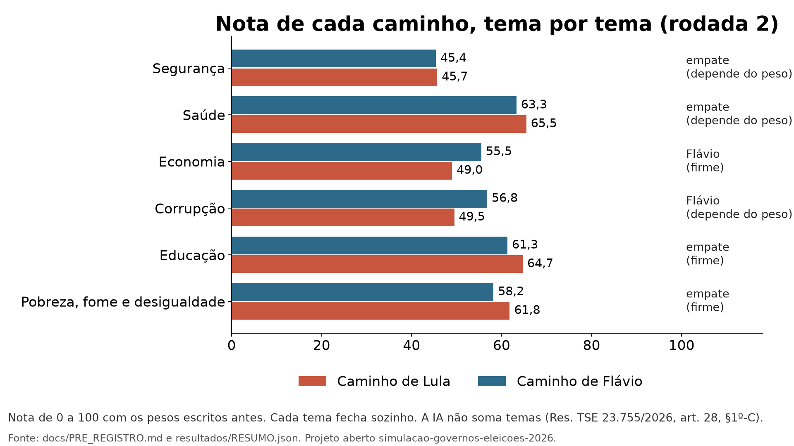
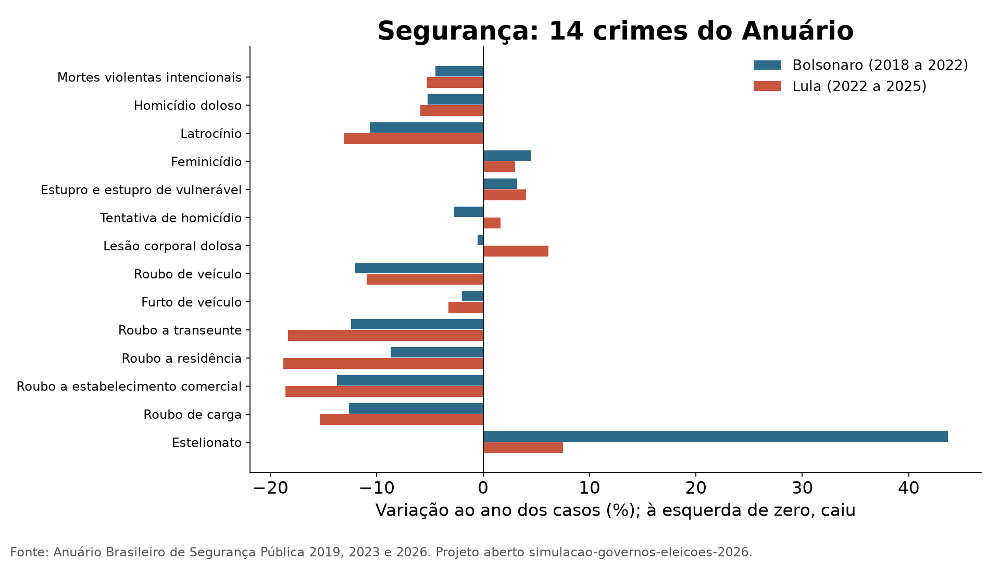
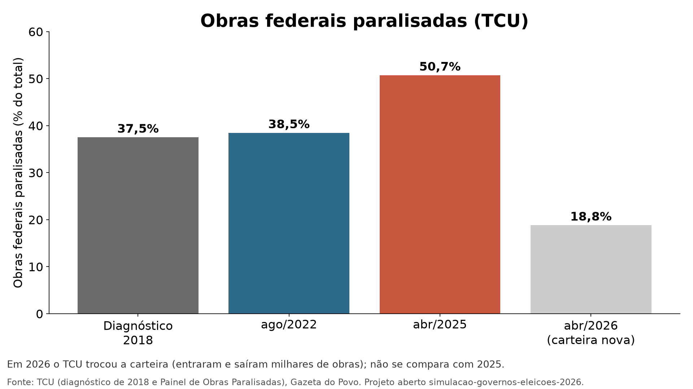
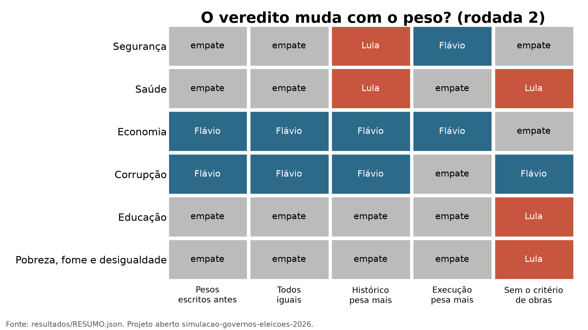
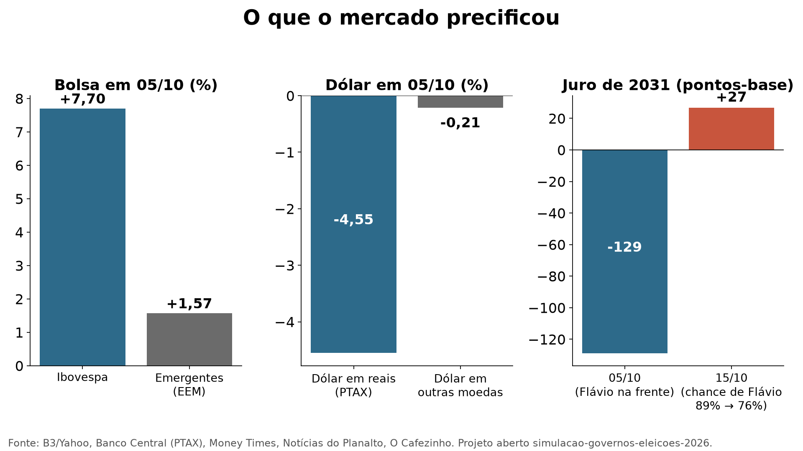
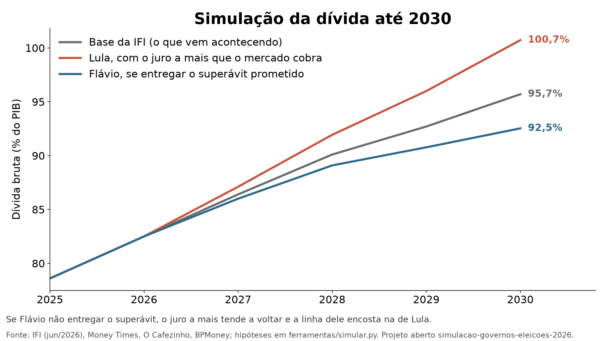

# Simulação: como tendem a andar seis temas no Brasil de 2027 a 2030, com Lula ou com Flávio Bolsonaro

**Rodada 2, gerada em 2026-10-20.** Análise feita pelo **Claude**, modelo de IA da Anthropic, posto pelo autor para analisar com regras escritas antes: pré-registro `1e73d27` e regras da rodada 2 `902202a` (emendas 6 a 11, publicadas antes destas notas, a pedido do autor depois de ver a rodada 1). A rodada 1 está guardada em `resultados/rodada1/`. Em uma página: [`RESUMO_SIMPLES.md`](RESUMO_SIMPLES.md). Opinião da IA: [`docs/LEITURA_DA_IA.md`](docs/LEITURA_DA_IA.md). Auditoria: [`docs/AUDITORIA_RODADA_2.md`](docs/AUDITORIA_RODADA_2.md). História: [`docs/HISTORIA_DO_PROJETO.md`](docs/HISTORIA_DO_PROJETO.md).

## O que este projeto não consegue dizer

- **Quem vai ganhar, nem quem deveria ganhar.** A IA não soma os temas e não diz quem é melhor para o país ([`docs/LIMITE_ELEITORAL.md`](docs/LIMITE_ELEITORAL.md)).
- **Se um governo causou a variação de um indicador.** O histórico é o que aconteceu no mandato, descontado o mundo quando há série de vizinhos.
- **Flávio Bolsonaro nunca governou.** O histórico dele é o do governo Jair Bolsonaro.
- **O resultado muda com o desenho.** Entre a rodada 1 e a rodada 2 vários temas mudaram de lado; a seção 5 diz de que escolha cada veredito depende.

## 1. O que mudou da rodada 1 para a rodada 2

| Mudança | Por quê |
|---|---|
| Promessa e entrega (C2) saiu da nota do tema | O balanço do g1 não separa tema e dava a mesma vantagem em todos |
| Propostas: só o que muda conta; manter o que já existe é base comum; mesmo programa, mesma nota | Na rodada 1 a continuidade contava quatro vezes, e o mesmo programa tinha nota diferente conforme o verbo |
| Segurança com 14 crimes do Anuário (antes 3) | Faltavam feminicídio, roubos e crimes contra a pessoa |
| Ideb na janela sem pandemia; desemprego contra a América Latina; mais duas medidas de saúde e a pobreza a US$ 8,30 | A pandemia e o ponto de partida pesavam diferente para cada governo |
| Critério novo: obras federais paralisadas (TCU) | Obras inacabadas e prazos |
| Tabela de contexto de cada mandato | Dificuldades e privilégios de cada governo |
| Correção de um erro de casas decimais na comparação | 0,3 menos 0,2 dava 0,0999 e virava empate |

## 2. Resultado por tema

| Tema | Rodada 1 | Rodada 2: Lula | Rodada 2: Flávio | Veredito da rodada 2 | Robustez (4 pesos) | O que mais pesou (pontos na diferença) |
|---|---|---:|---:|---|---|---|
| Segurança | Lula (61,2 × 42,7) | 45,7 | 45,4 | **empate** | depende do peso | histórico (a favor de Lula, 8,4); caminho de execução (a favor de Flávio, 4,9); maturidade e evidência (a favor de Flávio, 1,8) |
| Saúde | Lula (76,1 × 55,0) | 65,5 | 63,3 | **empate** | depende do peso | histórico (a favor de Lula, 15,0); obras paralisadas (a favor de Flávio, 15,0); dinheiro (a favor de Lula, 2,5) |
| Economia | Lula (58,5 × 51,6) | 49,0 | 55,5 | **Flávio** | firme | mercado (a favor de Flávio, 15,0); obras paralisadas (a favor de Flávio, 10,0); histórico (a favor de Lula, 8,0) |
| Corrupção | empate (51,8 × 54,5) | 49,5 | 56,8 | **Flávio** | depende do peso | histórico (a favor de Flávio, 14,7); caminho de execução (a favor de Lula, 7,1); maturidade e evidência (a favor de Lula, 2,4) |
| Educação | Lula (74,7 × 47,5) | 64,7 | 61,3 | **empate** | firme | obras paralisadas (a favor de Flávio, 15,0); histórico (a favor de Lula, 8,3); maturidade e evidência (a favor de Lula, 4,5) |
| Pobreza, fome e desigualdade | Lula (74,8 × 50,3) | 61,8 | 58,2 | **empate** | firme | obras paralisadas (a favor de Flávio, 15,0); histórico (a favor de Lula, 12,5); maturidade e evidência (a favor de Lula, 4,0) |

## 3. Tema a tema

### Segurança

**Veredito da rodada 2: empate** (Lula 45,7, Flávio 45,4; depende do peso). Notas por critério (Lula × Flávio): histórico 64 × 36 · caminho de execução 52 × 66 · maturidade e evidência 35 × 42 · dinheiro 0 × 12. O que mais pesou: histórico (a favor de Lula, 8,4); caminho de execução (a favor de Flávio, 4,9); maturidade e evidência (a favor de Flávio, 1,8); dinheiro (a favor de Flávio, 1,5). Com outros pesos: pesos iguais: empate (37,9 × 39,2); histórico pesa mais: Lula (50,5 × 42,0); execução pesa mais: Flávio (44,6 × 50,4).

**Histórico (C1).**

| Indicador | Bolsonaro (2019 a 2022) | Lula (2023 até o dado mais recente) | Quem fica na frente |
|---|---:|---:|---|
| Mortes violentas intencionais, variação ao ano dos casos (%) | -4,47 | -5,27 | empate |
| Homicídio doloso, variação ao ano dos casos (%) | -5,21 | -5,91 | empate |
| Latrocínio, variação ao ano dos casos (%) | -10,66 | -13,08 | Lula |
| Feminicídio, variação ao ano dos casos (%) | 4,48 | 3,02 | empate |
| Estupro e estupro de vulnerável, variação ao ano dos casos (%) | 3,21 | 4,04 | empate |
| Tentativa de homicídio, variação ao ano dos casos (%) | -2,72 | 1,65 | Bolsonaro |
| Lesão corporal dolosa, variação ao ano dos casos (%) | -0,50 | 6,15 | Bolsonaro |
| Roubo de veículo, variação ao ano dos casos (%) | -12,03 | -10,95 | empate |
| Furto de veículo, variação ao ano dos casos (%) | -1,96 | -3,26 | empate |
| Roubo a transeunte, variação ao ano dos casos (%) | -12,42 | -18,33 | Lula |
| Roubo a residência, variação ao ano dos casos (%) | -8,68 | -18,76 | Lula |
| Roubo a estabelecimento comercial, variação ao ano dos casos (%) | -13,75 | -18,56 | Lula |
| Roubo de carga, variação ao ano dos casos (%) | -12,60 | -15,35 | Lula |
| Estelionato, variação ao ano dos casos (%) | 43,69 | 7,51 | Lula |

Placar dos indicadores: Lula 6, Bolsonaro 2, empate 6.

**Propostas (C3, C4 e C5), só o que muda.**

| Lado | O que muda (página do plano) | Caminho (C3) | Maturidade (C4) | Dinheiro (C5) |
|---|---|---:|---:|---:|
| Lula | Cumprir as metas do Plano Pena Justa e criar o Pacto Nacional de Execução Penal (p. 28) | 80 | 35 | 0 |
| Lula | Criar o Ministério da Segurança Pública depois de aprovada a PEC da Segurança (repetida no debate) (p. 30) | 25 | 35 | 0 |
| Flávio | Declarar PCC, CV e milícias organizações narcoterroristas (repetida no debate) (p. 13) | 60 | 35 | 50 |
| Flávio | Reduzir a maioridade penal de 18 para 16 anos, e punir maiores de 14 por crimes graves (repetida no debate) (p. 13) | 25 | 35 | 0 |
| Flávio | Criar o Sistema Nacional de Fronteira com Exército, Marinha e Aeronáutica (repetida no debate) (p. 13) | 80 | 35 | 0 |
| Flávio | Consórcios e convênios com estados e municípios para investir em inteligência, territórios e polícia (p. 13) | 100 | 65 | 0 |

**Base comum** (continua com qualquer um dos dois, porque nenhum plano propõe encerrar; fica fora da nota): Manter a asfixia financeira do crime organizado, com a Lei Antifacção sancionada em 2026 (Lula, p. 27); Manter a política de controle de armas e munições (revogação dos decretos de acesso a armas) (Lula, p. 28).

### Saúde

**Veredito da rodada 2: empate** (Lula 65,5, Flávio 63,3; depende do peso). Notas por critério (Lula × Flávio): histórico 80 × 20 · caminho de execução 100 × 100 · maturidade e evidência 65 × 67 · dinheiro 25 × 0 · obras paralisadas 0 × 100. O que mais pesou: histórico (a favor de Lula, 15,0); obras paralisadas (a favor de Flávio, 15,0); dinheiro (a favor de Lula, 2,5); maturidade e evidência (a favor de Flávio, 0,3). Com outros pesos: pesos iguais: empate (54,0 × 57,3); histórico pesa mais: Lula (61,0 × 54,7); execução pesa mais: empate (69,2 × 73,0).

**Histórico (C1).**

| Indicador | Bolsonaro (2019 a 2022) | Lula (2023 até o dado mais recente) | Quem fica na frente |
|---|---:|---:|---|
| Esperança de vida, Brasil menos América Latina, variação ao ano | -0,09 | -0,01 | empate |
| Mortalidade infantil, Brasil menos América Latina, variação ao ano | 0,12 | 0,15 | empate |
| Vacina de sarampo, Brasil menos América Latina, variação ao ano | -0,17 | 3,42 | Lula |
| Vacina tríplice bacteriana (DTP3), Brasil menos América Latina, variação ao ano | -0,70 | 5,45 | Lula |
| Mortalidade materna, Brasil menos América Latina, variação ao ano | 6,50 | -21,00 | Lula |

Placar dos indicadores: Lula 3, Bolsonaro 0, empate 2.

**Propostas (C3, C4 e C5), só o que muda.**

| Lado | O que muda (página do plano) | Caminho (C3) | Maturidade (C4) | Dinheiro (C5) |
|---|---|---:|---:|---:|
| Lula | Impulsionar o Agora Tem Especialistas (filas de consultas, exames e cirurgias; repetida no debate) (p. 37) | 100 | 65 | 50 |
| Lula | Consolidar o prontuário único do cidadão pela Rede Nacional de Dados em Saúde (p. 35) | 100 | 65 | 0 |
| Flávio | Ampliar a Estratégia Saúde da Família (p. 37) | 100 | 100 | 0 |
| Flávio | Corrigir a tabela SUS para hospitais, santas casas e clínicas (p. 37) | 100 | 35 | 0 |
| Flávio | Implantar o prontuário eletrônico único ligado ao CPF (repetida no debate) (p. 26) | 100 | 65 | 0 |

**Base comum** (continua com qualquer um dos dois, porque nenhum plano propõe encerrar; fica fora da nota): Manter o apoio à expansão e qualificação das equipes de Saúde da Família (Lula, p. 34); Manter o Farmácia Popular 100% gratuito e incluir exames (Lula, p. 36); Manter a imunização e incentivar a produção nacional de vacinas (Flávio, p. 37).

**Obras paralisadas (C7):** a fatia de obras federais paradas no painel do TCU subiu 0,24 ponto por ano no período Bolsonaro e 4,59 pontos por ano no atual.

### Economia

**Veredito da rodada 2: Flávio** (Lula 49,0, Flávio 55,5; firme). Notas por critério (Lula × Flávio): histórico 70 × 30 · caminho de execução 90 × 60 · maturidade e evidência 50 × 35 · dinheiro 25 × 25 · mercado 0 × 100 · obras paralisadas 0 × 100. O que mais pesou: mercado (a favor de Flávio, 15,0); obras paralisadas (a favor de Flávio, 10,0); histórico (a favor de Lula, 8,0); caminho de execução (a favor de Lula, 7,5). Com outros pesos: pesos iguais: Flávio (39,2 × 58,3); histórico pesa mais: Flávio (44,5 × 54,0); execução pesa mais: Flávio (50,8 × 62,0).

**Histórico (C1).**

| Indicador | Bolsonaro (2019 a 2022) | Lula (2023 até o dado mais recente) | Quem fica na frente |
|---|---:|---:|---|
| PIB real, Brasil menos emergentes (p.p. ao ano, média) | -1,90 | -1,53 | Lula |
| Inflação, Brasil menos emergentes (p.p. ao ano, média) | -0,38 | -2,47 | Lula |
| Desemprego, Brasil menos América Latina, variação ao ano (p.p.) | -0,52 | -0,60 | empate |
| Dívida bruta, variação ao ano (p.p. do PIB; até 08/2026) | -0,90 | 3,05 | Bolsonaro |
| Rendimento médio real do trabalho, variação ao ano (%) | -0,25 | 3,61 | Lula |

Placar dos indicadores: Lula 3, Bolsonaro 1, empate 1.

**Propostas (C3, C4 e C5), só o que muda.**

| Lado | O que muda (página do plano) | Caminho (C3) | Maturidade (C4) | Dinheiro (C5) |
|---|---|---:|---:|---:|
| Lula | Manter os fundos garantidores, o controle de gastos com apostas e aprimorar regras de crédito (p. 49) | 80 | 35 | 50 |
| Lula | Fortalecer o Sistema Público de Emprego, Trabalho e Renda e a qualificação profissional (p. 74) | 100 | 65 | 0 |
| Flávio | Reformular as regras fiscais com foco na dívida, superávits e controle de gastos dos três Poderes (p. 71) | 60 | 35 | 100 |
| Flávio | Rever e redimensionar a reforma tributária para reduzir o IVA (p. 30) | 60 | 35 | 0 |
| Flávio | Simplificar a conta de luz e reduzir CDE, encargos e impostos sobre energia e combustíveis (p. 31) | 60 | 35 | 0 |
| Flávio | Reduzir gradualmente o custo do trabalho e criar contrato de primeiro emprego de 18 a 24 anos (p. 43) | 60 | 35 | 0 |

**Base comum** (continua com qualquer um dos dois, porque nenhum plano propõe encerrar; fica fora da nota): Manter o novo arcabouço fiscal (Lula, p. 49); Consolidar a reforma tributária do consumo em implementação (Lula, p. 48).

**Obras paralisadas (C7):** a fatia de obras federais paradas no painel do TCU subiu 0,24 ponto por ano no período Bolsonaro e 4,59 pontos por ano no atual.

### Corrupção

**Veredito da rodada 2: Flávio** (Lula 49,5, Flávio 56,8; depende do peso). Notas por critério (Lula × Flávio): histórico 25 × 75 · caminho de execução 78 × 58 · maturidade e evidência 45 × 35 · dinheiro 33 × 50. O que mais pesou: histórico (a favor de Flávio, 14,7); caminho de execução (a favor de Lula, 7,1); maturidade e evidência (a favor de Lula, 2,4); dinheiro (a favor de Flávio, 2,0). Com outros pesos: pesos iguais: Flávio (45,4 × 54,6); histórico pesa mais: Flávio (42,2 × 62,3); execução pesa mais: empate (57,5 × 54,2).

**Histórico (C1).**

| Indicador | Bolsonaro (2019 a 2022) | Lula (2023 até o dado mais recente) | Quem fica na frente |
|---|---:|---:|---|
| Percepção da Corrupção, Brasil menos média mundial, variação ao ano | 0,75 | -0,67 | Bolsonaro |
| Controle da Corrupção (Banco Mundial, 0 a 100), variação ao ano | -0,13 | 0,51 | empate |

Placar dos indicadores: Lula 0, Bolsonaro 1, empate 1.

**Propostas (C3, C4 e C5), só o que muda.**

| Lado | O que muda (página do plano) | Caminho (C3) | Maturidade (C4) | Dinheiro (C5) |
|---|---|---:|---:|---:|
| Lula | Aprofundar o Plano de Integridade e Combate à Corrupção 2025-2027 (p. 18) | 100 | 65 | 50 |
| Lula | Portal da Transparência com dados abertos e inteligência artificial (p. 18) | 100 | 35 | 0 |
| Lula | Medidas rígidas para barrar candidaturas de pessoas ligadas ao crime organizado (p. 27) | 35 | 35 | 50 |
| Flávio | Mais transparência, controle e rastreabilidade das emendas parlamentares (p. 69) | 60 | 35 | 50 |
| Flávio | Reforma do STF: fim do foro criminal originário, limite a decisões individuais, quarentena (p. 65) | 35 | 35 | 50 |
| Flávio | Estatais com comando técnico: fortalecer a Lei das Estatais e recrutar com regras de mercado (p. 70) | 80 | 35 | 50 |

### Educação

**Veredito da rodada 2: empate** (Lula 64,7, Flávio 61,3; firme). Notas por critério (Lula × Flávio): histórico 67 × 33 · caminho de execução 100 × 90 · maturidade e evidência 65 × 42 · dinheiro 50 × 25 · obras paralisadas 0 × 100. O que mais pesou: obras paralisadas (a favor de Flávio, 15,0); histórico (a favor de Lula, 8,3); maturidade e evidência (a favor de Lula, 4,5); caminho de execução (a favor de Lula, 3,0). Com outros pesos: pesos iguais: empate (56,3 × 58,2); histórico pesa mais: empate (58,2 × 58,1); execução pesa mais: empate (69,8 × 69,4).

**Histórico (C1).**

| Indicador | Bolsonaro (2019 a 2022) | Lula (2023 até o dado mais recente) | Quem fica na frente |
|---|---:|---:|---|
| Ideb dos anos iniciais, variação por edição (sem pandemia) | 0,10 | 0,30 | Lula |
| Ideb dos anos finais, variação por edição (sem pandemia) | 0,20 | 0,30 | Lula |
| Ideb do ensino médio, variação por edição (sem pandemia) | 0,40 | 0,20 | Bolsonaro |

Placar dos indicadores: Lula 2, Bolsonaro 1, empate 0.

**Propostas (C3, C4 e C5), só o que muda.**

| Lado | O que muda (página do plano) | Caminho (C3) | Maturidade (C4) | Dinheiro (C5) |
|---|---|---:|---:|---:|
| Lula | Ampliar o apoio a creches e pré-escolas pelo Novo PAC (p. 31) | 100 | 65 | 50 |
| Flávio | Priorizar o método fônico na alfabetização (p. 35) | 80 | 65 | 50 |
| Flávio | Ampliar a educação técnica no ensino médio, com o setor produtivo (p. 36) | 100 | 35 | 50 |
| Flávio | Ampliar creches em período integral e dar voucher-creche onde faltar vaga (p. 21) | 80 | 35 | 0 |
| Flávio | Qualificação contínua de professores baseada em evidências (p. 35) | 100 | 35 | 0 |

**Base comum** (continua com qualquer um dos dois, porque nenhum plano propõe encerrar; fica fora da nota): Seguir o Compromisso Nacional Criança Alfabetizada até 80% alfabetizados na idade certa (Lula, p. 31); Continuar e fortalecer o Pé-de-Meia (Lula, p. 32); Pé-de-Meia Licenciatura e Bolsa Mais Professores (repetida no debate) (Lula, p. 33).

**Obras paralisadas (C7):** a fatia de obras federais paradas no painel do TCU subiu 0,24 ponto por ano no período Bolsonaro e 4,59 pontos por ano no atual.

### Pobreza, fome e desigualdade

**Veredito da rodada 2: empate** (Lula 61,8, Flávio 58,2; firme). Notas por critério (Lula × Flávio): histórico 75 × 25 · caminho de execução 100 × 93 · maturidade e evidência 65 × 45 · dinheiro 0 × 0 · obras paralisadas 0 × 100. O que mais pesou: obras paralisadas (a favor de Flávio, 15,0); histórico (a favor de Lula, 12,5); maturidade e evidência (a favor de Lula, 4,0); caminho de execução (a favor de Lula, 2,0). Com outros pesos: pesos iguais: empate (48,0 × 52,7); histórico pesa mais: empate (56,5 × 53,2); execução pesa mais: empate (66,0 × 67,5).

**Histórico (C1).**

| Indicador | Bolsonaro (2019 a 2022) | Lula (2023 até o dado mais recente) | Quem fica na frente |
|---|---:|---:|---|
| Extrema pobreza (US$ 3 por dia), variação ao ano (p.p.) | -0,50 | -0,95 | Lula |
| Pobreza (US$ 8,30 por dia), variação ao ano (p.p.) | -0,85 | -2,35 | Lula |
| Gini do rendimento domiciliar per capita, variação ao ano | -0,007 | -0,002 | Bolsonaro |
| Subalimentação (FAO, média de 3 anos), variação ao ano (p.p.) | 0,23 | -0,45 | Lula |

Placar dos indicadores: Lula 3, Bolsonaro 1, empate 0.

**Propostas (C3, C4 e C5), só o que muda.**

| Lado | O que muda (página do plano) | Caminho (C3) | Maturidade (C4) | Dinheiro (C5) |
|---|---|---:|---:|---:|
| Lula | Cozinhas solidárias e restaurantes populares (p. 26) | 100 | 65 | 0 |
| Flávio | Prioridade e trilha de emprego e qualificação para beneficiários, com volta sem fila ao benefício (p. 43) | 80 | 35 | 0 |
| Flávio | Comida mais barata: corredores logísticos, seguro rural e armazenagem de safras (p. 31) | 100 | 35 | 0 |
| Flávio | Retomar o Casa Verde e Amarela com meta de 2,5 milhões de moradias (p. 47) | 100 | 65 | 0 |

**Base comum** (continua com qualquer um dos dois, porque nenhum plano propõe encerrar; fica fora da nota): Manter, aperfeiçoar e ampliar a proteção social e a transferência de renda (Bolsa Família) (Lula, p. 18); Continuar a valorização do salário mínimo (repetida no debate) (Lula, p. 74); Manter e ampliar o Minha Casa, Minha Vida (Lula, p. 45); Manter os programas sociais existentes, com gestão e combate a fraudes (Bolsa Família repetido no debate) (Flávio, p. 42).

**Obras paralisadas (C7):** a fatia de obras federais paradas no painel do TCU subiu 0,24 ponto por ano no período Bolsonaro e 4,59 pontos por ano no atual.

## 4. Contexto de cada mandato (herança e choques)

| | Bolsonaro (começo de 2019) | Lula (começo de 2023) |
|---|---|---|
| Selic no começo | 6,50% | 13,75% |
| Desemprego no começo | 11,7% | 7,9% |
| Dívida bruta no começo | 75,27% do PIB | 71,68% do PIB |
| Inflação do ano anterior | 3,75% | 5,78% |
| Crescimento médio dos emergentes no mandato | 3,33% ao ano | 4,50% ao ano |
| Choques | pandemia (2020 e 2021) e início da guerra na Ucrânia (2022) | tarifas dos Estados Unidos (2025), enchentes no Rio Grande do Sul (2024) e guerra no Irã (citada no plano de Lula) |

Na régua: os choques do mundo (pandemia, guerra) são descontados nos indicadores comparados com os vizinhos (PIB, inflação, desemprego, saúde), e a variação por ano ajusta o tempo de mandato. Lula começou com juro alto e desemprego baixo; Bolsonaro, com juro baixo e desemprego alto.

**Segurança:** O feminicídio subiu nos dois governos (4,48% ao ano no de Bolsonaro e 3,02% ao ano no atual; diferença menor que a mínima, empate). O roubo de celular caiu de 508.335 em 2022 para 308.723 em 2025 (sem dado comparável de 2018). Lesão corporal e tentativa de homicídio pioraram no período atual; roubo a transeunte, a residência, a comércio e de carga, e o latrocínio, caíram mais rápido no período atual.

**Grandes obras com atraso** (casos, sem nota): a transposição do São Francisco começou em 2007, tinha conclusão prevista para 2012 e foi dada como concluída em fevereiro de 2022 (captura O08); a Transnordestina começou em 2006 e segue sem conclusão em 2026 (O10, O11); o segundo trem da refinaria Abreu e Lima parou em 2015 e foi retomado em 2025, com previsão para 2029 (O12). Painel do TCU: 37,5% das obras paradas no diagnóstico de 2018, 38,5% em ago/2022 e 50,7% em abr/2025; em abr/2026 o painel mostra 18,8%, mas o TCU trocou a carteira e avisa que não se compara com 2025 (O03).

## 5. De que escolha cada veredito depende

- **O critério de obras (C7) é um número só, igual em quatro temas.** Ele dá a nota inteira a Flávio em saúde, educação, pobreza e economia. Sem ele: Saúde vira Lula (77,1 × 56,9); Economia vira empate (54,4 × 50,6); Educação vira Lula (76,1 × 54,5); Pobreza, fome e desigualdade vira Lula (72,6 × 50,9). É a mesma objeção que tirou o critério de promessa da nota (não ser específico do tema), e a base de 2018 é o diagnóstico do TCU, não o painel. A regra foi escrita antes da nota (emenda 10), então o veredito oficial fica, e a fragilidade vai junto.
- **Ideb com a pandemia na janela** (como na rodada 1): educação vira Flávio (60,5 × 65,5).
- **Economia sem o critério de mercado:** Lula (57,6 × 47,6).
- **A base comum supõe que os programas continuam com os dois.** Pé-de-Meia, Farmácia Popular, controle de armas e aumento real do salário mínimo não aparecem no plano de Flávio, nem para manter nem para acabar.

## 6. Mercado, dívida e Supremo

Iguais à rodada 1: o mercado reagiu a favor de Flávio no 1º turno (bolsa 6,14 pontos acima dos emergentes, real 4,35 pontos acima das outras moedas); a simulação dá dívida de 100,7% do PIB em 2030 com Lula e o juro que o mercado cobra, contra 92,5% com Flávio entregando o superávit prometido (base da IFI: 95,7%); e o próximo governo deve preencher de 3 a 4 vagas no STF, com o Senado de 2027 mais à direita.

## 7. Promessa e entrega, como informação geral

Pelo g1, com a mesma metodologia: Lula cumpriu 26 de 36 promessas de 2022 até junho de 2026 (4 em parte); o governo Bolsonaro cumpriu 19 de 58 de 2018 (17% em parte). Fora da nota do tema desde a rodada 2.

## 8. Números dos planos, conferidos

| Plano | Afirmação | Conferido | Situação |
|---|---|---|---|
| Flávio | Reduzimos em 4 pontos percentuais a relação entre a dívida e o PIB (governo Bolsonaro) (p. 29) | dez/2018 75,27% para dez/2022 71,68% (-3,6 pontos) | bate, arredondado |
| Flávio | Em quatro anos, a dívida pública cresceu 13 pontos percentuais em relação ao PIB (governo atual) (p. 29) | dez/2022 71,68% para 08/2026 82,87% (+11,2 pontos) | não bate com a dívida bruta do governo geral do Banco Central; o plano não diz que conceito usou |
| Lula | A inflação alcançou uma média anual de 4,6% (p. 10) | IPCA de dezembro a dezembro: 2023 4,62%, 2024 4,83%, 2025 4,26%; média 4,57% | bate |
| Lula | O Gini atingiu o menor patamar histórico de 0,504 (p. 12) | IBGE: 2024 0,504; 2025 0,511 | bate para 2024; na mesma série, 2025 subiu |
| Lula | A pobreza extrema recuou para o menor nível da série, de 4,6% da população (p. 12) | IBGE, linha de US$ 2,15: 4,4% em 2023 e 3,5% em 2024 (capturas X05 e X01) | não bate com a série do IBGE na linha de US$ 2,15; o plano não diz a linha |

## 9. Fontes, revisão e como refazer

Emendas: [`docs/PRE_REGISTRO.md`](docs/PRE_REGISTRO.md) §12. Teste das duas pontas: [`docs/TESTE_DAS_DUAS_PONTAS.md`](docs/TESTE_DAS_DUAS_PONTAS.md). Revisão das duas rodadas: [`docs/REVISAO_ADVERSARIAL.md`](docs/REVISAO_ADVERSARIAL.md). A história do projeto, na ordem: [`docs/HISTORIA_DO_PROJETO.md`](docs/HISTORIA_DO_PROJETO.md). A origem de cada método: [`docs/METODO.md`](docs/METODO.md). Fontes: [`docs/FONTES.md`](docs/FONTES.md). Refazer: [`docs/REPLICAR.md`](docs/REPLICAR.md).
